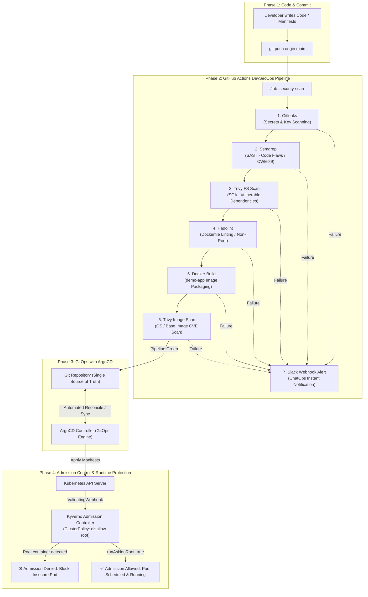

# Practical 9: End-to-End DevSecOps CI/CD Pipeline & Kubernetes Admission Control

---

## 1. Executive Summary & Project Overview

This project implements a complete, enterprise-grade **DevSecOps (Development, Security, and Operations)** pipeline and **Cloud-Native GitOps** deployment workflow. 

In traditional software development cycles, security testing was often treated as an isolated checkpoint conducted at the very end of the Software Development Life Cycle (SDLC) before production release. This legacy approach created friction between development and security teams, delayed product launches, and dramatically increased remediation costs.

This project demonstrates the **"Shift-Left Security"** paradigm: embedding automated, continuous security checks directly into the developer workflow—from the very first `git commit` in code, through static analysis, dependency scanning, container image linting, and automated ChatOps alerts, up to admission-time policy enforcement inside a Kubernetes cluster.

---

## 2. Why Do We Need DevSecOps?

### 2.1 The Traditional DevOps vs. DevSecOps Dilemma
In standard DevOps, Continuous Integration and Continuous Deployment (CI/CD) prioritize **velocity and release frequency**. Security teams ("Sec") were usually siloed. Audits, penetration tests, and compliance checks happened weeks after code was written.

| Feature | Traditional DevOps | DevSecOps |
| :--- | :--- | :--- |
| **Security Phase** | End of cycle (Gatekeeping) | Continuous at every stage (Shift-Left) |
| **Responsibility** | Dedicated Security Team | Shared responsibility between Dev, Sec, and Ops |
| **Vulnerability Detection**| In staging or production | During code push / pull request |
| **Feedback Loop** | Weeks or months | Seconds to minutes (Automated CI checks) |
| **Cost to Fix Defects** | Exponentially high (10x – 100x) | Minimal (Fixed immediately in developer branch) |
| **Release Velocity** | Blocked by manual security sign-offs | High velocity with continuous automated gates |

### 2.2 Boehm's Cost of Quality Curve
Industry studies (including NIST and IBM Security) demonstrate that discovering and fixing a security defect in production costs up to **30x to 100x** more than fixing it during the coding or build stage:
1. **Design / Code Stage**: ~$100 (minutes of developer time).
2. **Build / CI Stage**: ~$1,000 (automated test failure).
3. **QA / Staging Stage**: ~$2,500.
4. **Production Breach / Zero-Day**: Up to $100,000+ (outages, emergency patching, regulatory fines, brand damage).

---

## 3. Core Objectives of the Practical

1. **Automated Secret Detection**: Prevent accidental leakage of cloud provider credentials (e.g., AWS Access Keys, API tokens, private SSH keys) into version control using **Gitleaks**.
2. **Static Application Security Testing (SAST)**: Scan application source code for security anti-patterns, OWASP Top 10 flaws, and CWE vulnerabilities (specifically CWE-89 SQL Injection in Python Flask) using **Semgrep**.
3. **Software Composition Analysis (SCA)**: Identify known Common Vulnerabilities and Exposures (CVEs) in open-source third-party dependencies (`requirements.txt`) using **Trivy**.
4. **Container Infrastructure Linting**: Enforce Docker best practices (preventing running as `root`, avoiding untagged images, pinning base packages) using **Hadolint**.
5. **Container Image Vulnerability Scanning**: Inspect final built container layers for operating system and binary vulnerabilities using **Trivy Image Scan**.
6. **ChatOps & Real-Time Incident Notification**: Notify engineering and security teams instantly via **Slack Incoming Webhooks** upon any pipeline security failure.
7. **Declarative GitOps Continuous Delivery**: Use **ArgoCD** to synchronize cluster state continuously with the Git repository as the single source of truth.
8. **Runtime Admission Control & Policy-as-Code**: Enforce zero-trust admission policies in Kubernetes using **Kyverno** to guarantee that pods without `runAsNonRoot: true` can never be deployed, even if someone attempts a direct `kubectl apply`.

---

## 4. Deep-Dive: Tools Used & Why We Chose Them

### 4.1 Gitleaks (Secrets Detection)
- **Role**: Scans Git repositories and commits for hardcoded secrets, API tokens, passwords, and private certificates.
- **Why We Use It**: Human developers frequently commit `.env` files or hardcoded test credentials by mistake. Once pushed to a remote repository, keys can be scraped by automated botnets in seconds.
- **Detection Mechanism**: Uses high-speed regex pattern matching combined with Shannon entropy scoring to differentiate random high-entropy strings (genuine API keys) from standard English words or variables.

### 4.2 Semgrep (Static Application Security Testing - SAST)
- **Role**: Fast, open-source static analysis engine for finding bugs, enforcing code standards, and uncovering security vulnerabilities in application source code.
- **Why We Use It**: Unlike simple text searchers (`grep`), Semgrep parses source code into an Abstract Syntax Tree (AST). It understands code context, semantic scope, and data flow.
- **Demo Vulnerability**: Flags SQL Injection (CWE-89) in [app.py](file:///c:/Users/Dharm/OneDrive/Desktop/CN_DEVOPS/Prac_9/app.py#L32) where unsanitized user query parameters are directly concatenated into a SQL statement (`"SELECT ... WHERE username = '" + name + "'"`).

### 4.3 Trivy by Aqua Security (SCA & Container Image Scanner)
- **Role**: All-in-one security scanner for container images, file systems, Git repositories, and Kubernetes configurations.
- **Why We Use It**: 
  - In step 3 of the pipeline, Trivy scans `requirements.txt` (Filesystem scan) to identify vulnerable package versions against the National Vulnerability Database (NVD).
  - In step 6, Trivy scans the built Docker container image layers (`demo-app:sha`) for OS-level vulnerabilities (Debian/Alpine CVEs).
- **Key Feature**: Extremely fast, regularly updated vulnerability database, supports `exit-code: 1` to fail CI builds on `HIGH` or `CRITICAL` severity findings.

### 4.4 Hadolint (Dockerfile Linter)
- **Role**: A Dockerfile linter that parses the Dockerfile into an AST and inspects it against predefined security rules and Dockerfile best practices.
- **Why We Use It**: Enforces container hygiene. Catches rule **DL3002** ("Last user should not be root"). Running containers as `root` is dangerous: if an attacker achieves container escape, they obtain root privileges on the underlying host node.

### 4.5 Slack Webhook (ChatOps Notification)
- **Role**: Dispatches structured JSON alerts to a dedicated Slack channel when any CI step fails.
- **Why We Use It**: Security visibility is critical. Developers should not have to manually poll GitHub Actions logs. Immediate alerts provide commit SHA, author, and failing repository details to speed up triage.

### 4.6 ArgoCD (GitOps Continuous Delivery)
- **Role**: A declarative, GitOps continuous delivery tool for Kubernetes.
- **Why We Use It**:
  - Pull-based deployment model: The cluster pulls manifests from Git instead of requiring external CI systems to hold high-privilege cluster admin credentials.
  - Automatic drift detection: If an engineer alters a resource manually inside Kubernetes using `kubectl edit`, ArgoCD flags the drift and can automatically reconcile it back to the Git state.

### 4.7 Kyverno (Kubernetes Native Policy Engine)
- **Role**: A Kubernetes admission controller that can validate, mutate, and generate Kubernetes resources using declarative YAML policies.
- **Why We Use It**: Even if a container passes CI, an operator or rogue script could deploy an unapproved manifest directly to the cluster. Kyverno intercepts Kubernetes API requests at the admission webhook phase and blocks non-compliant resources (e.g., rejecting any pod that lacks `securityContext.runAsNonRoot: true`).

---

## 5. Alternative Tools & Comparison Matrix

In an enterprise environment, multiple tools exist for each layer of the DevSecOps stack. Below is a comparative analysis explaining alternatives and why our selected stack is optimal for this demo and cloud-native workflows:

| Security Layer | Implemented Tool | Industry Alternatives | Why We Chose Our Tool |
| :--- | :--- | :--- | :--- |
| **Secret Scanning** | **Gitleaks** | TruffleHog, Git-secrets, SpectralOps, GitHub Secret Scanning | Gitleaks is lightweight, extremely fast in CI pipelines, supports zero-dependency Go binary execution, and offers customizable rules. |
| **SAST (Static Code Analysis)** | **Semgrep** | SonarQube, Checkmarx, Snyk Code, Fortify, Bandit | Semgrep runs in seconds (compared to SonarQube's heavy Java server footprint), uses intuitive YAML rule syntax, and parses code semantically without requiring a full project build. |
| **SCA & Dependency CVEs** | **Trivy (FS Scan)** | Snyk Open Source, OWASP Dependency-Check, Dependabot, Anchore | Trivy has negligible startup overhead, updates vulnerability databases transparently, and requires no proprietary account/API keys for basic CI usage. |
| **Dockerfile Linting** | **Hadolint** | Dockerfile-lint, Checkov, KubeLinter | Hadolint is the recognized industry standard for Dockerfile linting based on Haskell parsing; catches container privilege anti-patterns out of the box. |
| **Container Image Scanning** | **Trivy (Image Scan)** | Clair, Docker Scout, Anchore Grype, AWS ECR Inspector | Unified scanner: using Trivy for both file system and image layers reduces pipeline tooling complexity and learning curve. |
| **GitOps Continuous Delivery** | **ArgoCD** | FluxCD, Jenkins X, GitLab Agent for K8s | ArgoCD provides an intuitive, rich Web GUI, multi-cluster support, and granular application health/sync visualization. |
| **Kubernetes Policy as Code** | **Kyverno** | Open Policy Agent (OPA) / Gatekeeper, Datree, Pod Security Admission (PSA) | Kyverno policies are written in **pure Kubernetes YAML**! Unlike OPA Gatekeeper, engineers do not need to learn a complex domain-specific language like Rego. |

---

## 6. Real-World Relevance & Compliance Standards

Implementing this automated pipeline addresses mandatory requirements across leading cybersecurity standards:

1. **OWASP Top 10 (2021)**:
   - **A03:2021 – Injection**: Caught by Semgrep SAST.
   - **A06:2021 – Vulnerable and Outdated Components**: Caught by Trivy SCA.
   - **A07:2021 – Identification and Authentication Failures / Hardcoded Secrets**: Caught by Gitleaks.
2. **CIS Kubernetes Benchmark**:
   - Section 5.2 (Pod Security Policies / Standards): Enforced by Kyverno (`runAsNonRoot`).
3. **NIST SP 800-190 (Application Container Security Guide)**:
   - Recommends automated image vulnerability scanning, least-privilege container execution, and admission control validation before pod scheduling.
